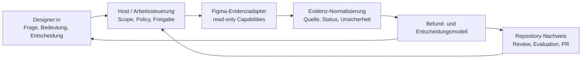
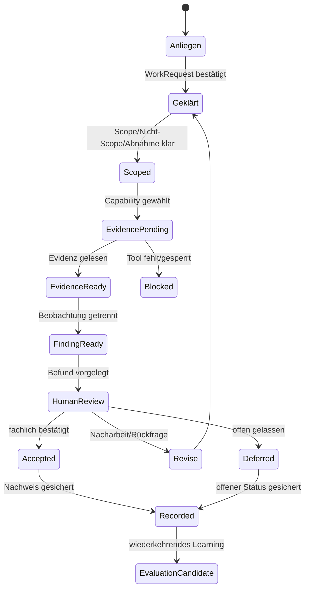

# Dev-ready Planung: Designer-Assistenzsystem

## Status und Transparenz

Dieser Plan ist ein unverbindlicher Systementwicklungsbefund im Modus
`Vorschlag` mit anschließendem `Status sichern`. Er beschreibt eine
implementierbare Zielarchitektur und einen begrenzten Umsetzungspfad. Er ist
keine neue Decision, keine bestätigte Regel und kein Auftrag, Figma oder eine
neue Infrastruktur zu verändern.

**Aktualitätsvermerk:** Der Plan bleibt Vorschlags- und Referenzquelle. Die
früheren S0–S2-Umsetzungsschnitte sind historische Planungspfade; der aktuelle
Arbeitsstand wird durch E-074/E-075 und die dort vorgeschlagene Status- und
Quellenkonsolidierung bestimmt.

| Feld | Einordnung |
|---|---|
| Ziel | Die vorhandene Governance und Arbeitsteilung in einen dev-ready, prüfbaren Arbeitsablauf für Designer:innen überführen. |
| Gegenstand | Designer-Assistenzsystem zwischen Designer:in, Codex-Host, Figma-Evidenz und Repository. |
| Nutzungsebene | `Systementwicklung`; fachliche Nutzung getrennt berücksichtigt. |
| Modus | `Vorschlag` mit anschließendem `Status sichern`. |
| Rolle | Systemisch nutzerzentrierte Architektur, Development und Governance. |
| Interne Quellen | `AGENTS.md`, `docs/README.md`, Base Template, Decisions, Evaluation Framework/Log, Rollen/User Stories, Operations, Tooling Map und bestehender Research. |
| Externe Quellen | Offizielle Figma-, MCP-, W3C-, NIST- und JSON-Schema-Quellen; Übertragungsgrenzen sind im Research ausgewiesen. |
| Automatisch ausgeführt | Quellen-/Statusanalyse, Best-Practice-Research, Architektur-Synthese, Anforderungen, Umsetzungsschnitte und Abnahmelogik. |
| Nicht verändert | Figma, externe Dienste, kanonische Decisions, Wiki-Detailseiten, Toolkonfigurationen und Produktionscode. |
| Menschlich zu entscheiden | Geltungsbereich, Zielarchitektur, Datenvertrag, Integrationsfreigabe und Start des ersten Umsetzungsslices. |
| Tooling-Grenze | Das Repository enthält keine bestehende Laufzeit, Produkt-Codebasis oder bestätigte Figma-Integrationsfreigabe. Ein Framework wird daher nicht vorausgesetzt. |
| Genau ein nächster Schritt | Diesen Plan menschlich bewerten und den Startumfang für die Architektur-Reconciliation freigeben oder zurückweisen. |

## 1. Ausgangslage und Zielstellung

Das Repository enthält bereits die fachlichen Voraussetzungen für eine
Assistenz: Rollen, Entscheidungsrechte, `PROMPT`/`AUSFÜHREN`, Evidenzstatus,
Tool-Fit, Freigaben, Evaluation und repo-first Nachweisführung. Diese
Voraussetzungen liegen jedoch über mehrere Dokumenttypen verteilt und werden
noch überwiegend im Chat zusammengeführt.

Das Ziel ist deshalb kein neuer allgemeiner Agentenbaukasten. Das Ziel ist ein
arbeitsfähiger, schrittweise implementierbarer **Arbeitsvertrag zwischen
Designer:in, Assistenz, Figma und Repository**:

```text
fachliches Anliegen
  → geführte Klärung und Scope
  → kleinste passende Quelle/Funktion
  → begrenzte Figma-Evidenz
  → strukturierter Befund mit Evidenzstatus
  → menschliche Bewertung und Entscheidung
  → repo-basierter Nachweis
  → kontrollierter Rückfluss in Evaluation und spätere Regelkandidaten
```

Der erste technische Ausbau muss diesen Ablauf sichtbar und prüfbar machen,
ohne vorab eine eigene Agentenlaufzeit, Code-Integration oder automatische
Figma-Schreibstrecke zu bauen.

## 2. Systemische Bestandsanalyse

### 2.1 Quellen-, Status- und Funktionsmatrix

| Quelle/Bereich | Dokumentierter Status | Aktuelle Funktion | Architekturfolge |
|---|---|---|---|
| `AGENTS.md` | unmittelbar ausführbarer Arbeitsvertrag | Kontext, Modus, Rollen, Grenzen, Transparenz, `PROMPT`/`AUSFÜHREN` | bleibt Einstieg und Policy-Referenz; keine zweite Detailablage erzeugen |
| `docs/README.md` | operative Einstiegskarte | Quellen- und Funktionsmatrix, selektiver Kontextstart, Wiki-Freeze | dient als Routing, nicht als Produkt-Spezifikation |
| Base Template v0.1/v0.2/v0.3 | `Entwurf`, historisch gewachsene Staffelung | generischer Design-System-Rahmen und Figma-Testpfad | als Historie bzw. Vergleich markieren; nicht als aktuelles Produktziel verwenden |
| Decisions D-017, D-018, D-025, D-026, D-028, D-029, D-031 bis D-036 | `bestätigt` | Leanheit, Arbeitsauftrag, Nutzungsebene, Tool-Fit, Evidenz, KI-Freigabe, Komponenten- und Dokumentationsgrenzen | bilden die tragenden Architekturregeln |
| Decisions D-009 bis D-016 | überwiegend `Entwurf`, praktisch referenziert | Rollen, Transparenz, Toolwahl, Evidenz, Regelkandidaten, Delta-Nachweis | Statusabgleich vor verbindlicher Implementierung erforderlich |
| `role-needs-and-user-stories.md` | bestätigt durch D-021/D-022, praktische Validierung offen | Anforderungen von Design, Development, Review und Governance | liefert Nutzer- und Abnahmekriterien |
| Operations/Checklists | operative Regel- und Prüfschritte | Auftrag, Toolwahl, Evidenz und Evaluation | werden als Prozessregeln, nicht als Runtime-Code kopiert |
| Tooling Map und Figma-Tooling | Funktions- und Grenzbeschreibung, teils historisch breit | Auswahl passender Figma-Funktionen und externe Dienstgrenzen | Capability-Registry braucht aktiven/inaktiven Status statt impliziter Verfügbarkeit |
| Evaluation Log | Historie und Rückfluss | Befunde, Status, nächste Schritte | bleibt Historie; aktuelle Steuerung braucht verdichtete Statussicht |
| Wiki | Pflege pausiert durch E-071 | menschliche Einordnung | keine operative Abhängigkeit und keine neue Vermittlungsschicht |
| `reviews/qa-architecture-research-2026-10-20.md` | unverbindlicher Architekturvorschlag | Zielbild und systemischer Umbaupfad | Ausgangspunkt für diesen dev-ready Plan, nicht kanonische Architektur |

### 2.2 Reale Nutzerarbeit

Die Designerin bzw. der Designer bringt die fachliche Frage, den Gegenstand,
die Bedeutung, Priorität und Abnahme ein. Er oder sie muss keine MCP-Funktion,
Node-ID oder API-Syntax kennen. Entscheidend ist, dass ein Befund für Zweck,
Zustände, visuelle Systemlogik, Tokens, Accessibility und Qualität eingeordnet
werden kann.

Der Agent übernimmt die Vermittlungsarbeit: Anliegen spiegeln, fehlenden
Kontext sichtbar machen, Scope begrenzen, die kleinste passende Funktion
wählen, Evidenz sammeln, Unsicherheit markieren und einen Befund zur
menschlichen Bewertung vorbereiten. Er bestimmt weder Bedeutung noch
Priorität und erteilt keine Freigabe.

### 2.3 Gegenwärtige Brüche und Fehlerquellen

1. **Kontextbruch:** Anforderungen stehen an mehreren Stellen; ohne
   Arbeitsvertrag im laufenden Vorgang wird der Chat zur Integrationsschicht.
2. **Statusbruch:** Entwurfsentscheidungen werden praktisch referenziert,
   obwohl ihr verbindlicher Status offen ist.
3. **Toolbruch:** Eine vorhandene Verbindung wird leicht mit nachgewiesener
   Eignung, Berechtigung oder fachlicher Vollständigkeit verwechselt.
4. **Evidenzbruch:** Screenshot, Variablenwert oder Node-Struktur werden zu
   schnell als semantische, Accessibility- oder Freigabeaussage gelesen.
5. **Verantwortungsbruch:** Lesen, Bewerten, Vorschlagen, Schreiben und
   Freigeben werden in einem Prompt vermischt.
6. **Lebenszyklusbruch:** Historische Roadmaps, Pilotbefunde und aktive Regeln
   sind nicht in einer kompakten Steuerung auseinandergehalten.
7. **Pflegebruch:** Eine zusätzliche Wiki- oder Toolschicht würde den bereits
   dokumentierten Kontext- und Pflegeaufwand erhöhen.

## 3. Best-Practice-Research und Übertragung

Die Recherche wurde auf Quellen begrenzt, die für den konkreten Systemkern
relevant sind. Sie liefert Prinzipien und Grenzen, keine automatische
Technologieauswahl.

| Primärquelle | Befund | Übertragung in dieses System | Grenze |
|---|---|---|---|
| [Figma MCP Introduction](https://developers.figma.com/docs/figma-mcp-server/) und [Tools and prompts](https://developers.figma.com/docs/figma-mcp-server/tools-and-prompts/) | Figma stellt getrennte Lese- und Schreibfunktionen bereit. Für konkrete Auswahl sind u. a. Metadaten, Designkontext, Screenshot und verwendete Variablen verfügbar. Remote/Desktop, Plan, Seat und Linkkontext unterscheiden sich. | Der Adapter führt eine explizite Capability-Liste. Der Standardpfad nutzt nur die kleinste read-only Funktion, die die Frage beantwortet. | Toolverfügbarkeit, Plan, Berechtigung und Vollständigkeit sind fallbezogen zu prüfen; ein Toolergebnis beweist keine fachliche Bedeutung. |
| [Figma Write to canvas](https://developers.figma.com/docs/figma-mcp-server/write-to-canvas/) | Canvas-Schreiben ist Beta, benötigt Edit-Zugriff und soll vor produktiver Nutzung an Kopie/Draft geprüft und manuell bereinigt werden. | Schreibaktionen erhalten einen separaten Lebenszyklus mit Freigabe, Ausführung und visueller Nachprüfung. Sie gehören nicht in den ersten Read-only-Slice. | Keine Aussage, dass Schreiben für dieses Projekt freigegeben oder wirtschaftlich ist. |
| [MCP Specification 2025-11-25](https://modelcontextprotocol.io/specification/2025-11-25) und [Architecture](https://modelcontextprotocol.io/specification/2025-11-25/architecture) | Host steuert Kontext, Berechtigungen und Einwilligung; Client isoliert Serververbindungen; Server liefern fokussierte Capabilities. Tools sind potenziell ausführbare Aktionen. | Policy, Scope und Freigabe bleiben beim Host/Arbeitsvertrag. Figma-Adapter bleiben fokussiert und sehen nicht den gesamten Arbeitskontext. Capability-Negotiation wird als Modell für Toolstatus verwendet, nicht als Anlass für eigene MCP-Orchestrierung. | Die Spezifikation ersetzt keine projektspezifische ISMS-, Daten- oder Rollenfreigabe. Der aktuelle Draft ist nicht automatisch Zielversion. |
| [W3C WCAG 2.2 Conformance](https://www.w3.org/WAI/WCAG22/Understanding/conformance) und [WAI-ARIA States and Properties](https://www.w3.org/TR/aria-state/) | Accessibility-Aussagen müssen programmatisch bestimmbar und für assistive Technologien verfügbar sein. Visuelle Repräsentation allein reicht nicht. | Befundmodell trennt visuelle Figma-Evidenz von Accessibility-Nachweis. Nicht belegte Accessibility-Aspekte werden offen bzw. nicht bewertet geführt. | Das System kann ohne ausführbare Zieloberfläche keine vollständige Accessibility-Abnahme liefern. |
| [NIST AI RMF 1.0](https://www.nist.gov/itl/ai-risk-management-framework) | Rollen, Verantwortung, Human-AI-Konfiguration, laufende Prüfung und sichere Ablösung sollen explizit und über den Lebenszyklus verfolgt werden. | Ownership-Matrix, Stop-Zustände, Evaluation-Rückfluss, Deaktivierungs- und Ablösepfad werden als Architekturbestandteile behandelt. | NIST ist freiwilliger Governance-Rahmen und ersetzt keine interne Entscheidung oder rechtliche Prüfung. |
| [JSON Schema Draft 2020-12](https://json-schema.org/draft/2020-12) | Strukturierte Datenverträge können maschinenlesbar validiert und versioniert werden. | Für Work Request, Evidence Packet, Finding und Decision wird ein später validierbarer Vertrag vorgesehen, bevor eine Runtime gebaut wird. | Die Schema-Spezifikation entscheidet nicht über fachliche Bedeutung, Status oder Freigabe. Ein Schema darf keine neue Regel stillschweigend erzeugen. |
| [OpenAI Agents SDK – Guardrails/HITL/Tracing](https://openai.github.io/openai-agents-python/) | Guardrails, menschliche Unterbrechung und Tracing sind verbreitete Runtime-Muster. | Als Vergleichsmuster für Stopppunkte, Freigaben und Nachweisbarkeit dokumentiert. | Kein Anlass, dieses SDK oder eine Multi-Agenten-Runtime einzuführen; ein realer Wiederholungsbedarf ist noch nicht belegt. |

### 3.1 Synthese der Research-Folgen

Aus dem Research werden nur sechs konkrete Architekturfolgen übernommen:

1. **Host-Policy vor Tool:** Die Arbeitssteuerung entscheidet Scope,
   Berechtigung und Freigabe; der Figma-Adapter liefert nur Evidenz.
2. **Capability statt Toolname:** Ein Tool wird als Fähigkeit mit Status,
   Reichweite, Datenklasse und Berechtigung geführt.
3. **Read-only als Standard:** Lesen und Schreiben haben getrennte Verträge.
4. **Evidence-first:** Figma-Sicht, Struktur, Variable und Screenshot werden
   typisiert; Bedeutung und Accessibility bleiben getrennte Prüfungen.
5. **Structured record:** Wiederkehrende Arbeitsgänge brauchen einen
   versionierbaren Befundvertrag, bevor eine eigene Runtime sinnvoll ist.
6. **Lifecycle ownership:** Jede Stufe hat eine verantwortliche Rolle,
   Stopppunkte und eine Ablöseoption.

## 4. Zielarchitektur

### 4.1 Systemgrenze



**Im Zielbild enthalten:** fachliche Auftragsklärung, Scope-/Toolrouting,
read-only Figma-Evidenz, Befund- und Entscheidungsstruktur, Repository-
Nachweis, Evaluation und kontrollierter Rückfluss.

**Nicht enthalten:** Code Connect, Design-to-Code, Produktionscode,
Synchronisation, automatische Token-/Komponentenerzeugung, ungeprüftes
Canvas-Schreiben, Multi-Agenten-Orchestrierung, neue Wiki-Schicht und ein
zusätzlicher MCP-Server.

### 4.2 Verantwortungsgrenzen

| Baustein | Verantwortet | Darf nicht übernehmen |
|---|---|---|
| Intake/Arbeitsvertrag | fachlich verständliche Anfrage, Ziel, Gegenstand, Scope und Abnahme | fehlende Bedeutung erraten |
| Policy/Orchestrator | Modus, Quellenhierarchie, Capability-Auswahl, Stop-/Freigabepunkte | fachliche Entscheidung oder stille Scope-Erweiterung |
| Figma-Evidenzadapter | konkret angeforderte read-only Struktur-, Screenshot- oder Variableninformation | semantische oder Accessibility-Freigabe |
| Evidenz-Normalisierung | Quelle, Evidenztyp, Sichtbarkeit, Vollständigkeit und Unsicherheit | Evidenz in eine bestätigte Regel umwandeln |
| Befundmodell | Beobachtung, Ableitung, Auswirkung, Optionen, offene Prüfung | Entscheidung des Designers ersetzen |
| Repository-Recorder | nachvollziehbaren Status, Befund, Entscheidung und nächsten Schritt sichern | unklare Aussagen kanonisieren |
| Designer-Ansicht | verständliche Orientierung, Befund, Optionen und Handlungsfähigkeit | technische Tooldetails als Pflichtwissen verlangen |

### 4.3 Capability-Registry

Eine spätere Implementierung braucht eine kleine, explizite Registry. Sie ist
kein Verzeichnis aller verfügbaren Tools, sondern ein Nachweis der für den
Arbeitsgang zulässigen Fähigkeiten:

| Feld | Zweck |
|---|---|
| `capability_id` | stabile Funktionskennung, z. B. `figma.metadata.read` |
| `source_kind` | Figma, Repository oder lokale Regelquelle |
| `operation` | Lesen, Vorschlagen, Schreiben oder Validieren |
| `input_scope` | Link, Node, Section, Datei oder Repository-Pfad |
| `output_evidence` | E0–E4 bzw. klar benannter Nachweistyp |
| `permission` | keine, read-only, edit, externe Veröffentlichung |
| `data_class` | synthetisch, freigegeben, vertraulich oder gesperrt |
| `availability` | `confirmed`, `restricted`, `unknown`, `blocked` |
| `limitations` | bekannte Reichweiten- und Vollständigkeitsgrenzen |
| `owner/source` | verbindliche Detailquelle und verantwortliche Pflege |

Eine Capability gilt nicht als verfügbar, weil ein Connector konfiguriert ist.
Sie muss für das konkrete Setup erreichbar, passend und freigegeben sein.

## 5. Fachlicher und technischer Arbeitsvertrag

### 5.1 Minimaler Arbeitsauftrag

Der Designer darf fachlich formulieren. Die Assistenz erzeugt daraus intern
einen strukturierten `WorkRequest` und zeigt eine verständliche Fassung:

```yaml
work_request:
  question: fachliche Frage
  subject: konkreter Figma-/Repository-Gegenstand
  usage_level: fachliche_nutzung | systementwicklung | verbunden
  mode: lesen | vorschlag | pilot | umsetzen
  role: design | development | review | governance | neutral
  action: lesen | analysieren | vorschlagen | validieren | schreiben
  scope: begrenzter Umfang
  non_scope: ausdrücklich nicht betroffene Bereiche
  expected_result: erwarteter Befund oder Nachweis
  acceptance: menschlich prüfbare Abnahme
```

Das ist zunächst ein vorgeschlagener Vertrag. Er wird erst nach menschlicher
Bewertung als maschinenlesbares Schema umgesetzt.

### 5.2 Evidenzvertrag

```yaml
evidence_packet:
  evidence_id: stabile Lauf-ID
  source: konkrete Quelle und Link/Referenz
  capability_id: verwendete Funktion
  scope_read: tatsächlich gelesener Umfang
  evidence_type: E0 | E1 | E2 | E3 | E4
  observations: sichtbare Informationen
  omissions: nicht sichtbare oder nicht gelesene Informationen
  completeness: complete | partial | unknown | failed
  tool_status: confirmed | restricted | unknown | blocked
  captured_at: Zeitpunkt
```

E0–E4 folgen der bestehenden Tooling-Definition: Inventar, Strukturmetadaten,
Detailkontext, Screenshot und menschlich bestätigte Bedeutung. Sie sind keine
Qualitätsrangfolge.

### 5.3 Befund- und Entscheidungsvertrag

```yaml
finding:
  finding_id: stabile Lauf-ID
  work_request_id: Bezug zum Auftrag
  evidence_ids: verwendete Evidenz
  observation: belegte Beobachtung
  inference: begrenzte Ableitung oder none
  impact: mögliche fachliche Auswirkung
  status: visible | derived | not_assessed | not_proven | open | blocked
  options: zulässige Handlungsoptionen
  recommendation: optionaler Vorschlag, keine Freigabe
  human_decision:
    state: pending | accepted | rejected | revise | deferred
    rationale: menschliche Begründung
  next_step: genau eine nächste Aktion
```

Die Felder `recommendation` und `human_decision` sind strikt getrennt. Ein
Vorschlag wird nicht durch Speicherung zur Entscheidung.

### 5.4 Repository-Nachweis

Ein gespeicherter Lauf muss mindestens aufweisen:

- Auftrag und tatsächlichen Scope;
- Quelle, Capability und Toolingstatus;
- Evidenz und nicht sichtbare Aspekte;
- Befund, Ableitung und Unsicherheit;
- menschliche Bewertung oder offene Entscheidung;
- Status des Artefakts;
- genau einen nächsten Schritt;
- Link auf das Review-/Evaluation-Artefakt.

Der Chat darf eine laufende Interaktion sein, aber keine notwendige
Wissensquelle bleiben.

## 6. Zustands- und Freigabemodell



### 6.1 Pflicht-Stopps

Der Ablauf stoppt sichtbar bei:

- unklarem Gegenstand oder fehlendem Scope;
- fehlender Mindestquelle;
- nicht bestätigter, gesperrter oder unpassender Capability;
- unvollständiger oder widersprüchlicher Evidenz;
- Ableitung ohne Beleg;
- fehlender menschlicher Entscheidung;
- jeder Schreibaktion ohne explizite Freigabe;
- fehlender ISMS-/Datenfreigabe für externe KI-Dienste.

Ein Stop erzeugt einen Befund mit Status `blocked`, `unknown` oder `open`. Er
führt nicht zu einer stillen Ersatzfunktion.

### 6.2 Schreibpfad als separater Lebenszyklus

```text
write_proposed
  → human_approved
  → executed_in_isolated_scope
  → visually_and_functionally_validated
  → recorded_or_rolled_back
```

Dieser Pfad ist nicht Bestandteil des ersten Umsetzungsslices. Figma weist
selbst auf Beta-Status, Edit-Rechte, Draft-/Kopietests und manuelle Prüfung
hin.

## 7. Dev-ready Anforderungen

### Funktionale Anforderungen

| ID | Anforderung | Abnahme |
|---|---|---|
| FR-01 | Designeranliegen werden ohne MCP-Syntax aufgenommen. | Ein fachlicher Auftrag kann mit Frage und Gegenstand beginnen. |
| FR-02 | Der Arbeitsvertrag zeigt Ziel, Ebene, Modus, Rolle, Aktion, Scope, Nicht-Scope, Ergebnis und Abnahme. | Kein Auftrag startet mit fehlendem Pflichtfeld. |
| FR-03 | `PROMPT` und `AUSFÜHREN` bleiben getrennte Kontrollpunkte. | Ausführung ohne bestätigten Prompt wird abgewiesen. |
| FR-04 | Die Assistenz wählt die kleinste passende Capability. | Befund nennt Capability und tatsächlichen Scope. |
| FR-05 | Capabilitystatus und Berechtigungsgrenze werden vor Nutzung geprüft. | `unknown`, `restricted` und `blocked` stoppen oder begrenzen den Ablauf. |
| FR-06 | Figma-Leseergebnisse werden als E0–E4 und mit Auslassungen erfasst. | Nicht gelesene Bereiche sind sichtbar. |
| FR-07 | Beobachtung, Ableitung, Unsicherheit und Accessibility-Grenze werden getrennt dargestellt. | Screenshot/Node-Wert erzeugt keine automatische Fachabnahme. |
| FR-08 | Befunde stellen Optionen und Auswirkungen verständlich dar. | Designer:in kann bestätigen, zurückweisen, nacharbeiten oder offen lassen. |
| FR-09 | Menschliche Entscheidung ist ein eigener Status mit Begründung. | Empfehlung und Entscheidung sind technisch/semantisch getrennt. |
| FR-10 | Nur bestätigte oder bewusst offene Ergebnisse werden gespeichert. | Chat allein reicht nicht als Abschluss. |
| FR-11 | Repository-Nachweis enthält Quelle, Status und genau einen nächsten Schritt. | Dritte können den Lauf ohne Chat rekonstruieren. |
| FR-12 | Tests sind isoliert und reversibel. | Kein Test verändert kanonische Quellen ohne Rückfluss und Freigabe. |
| FR-13 | Schreibaktionen haben einen separaten Freigabe- und Validierungspfad. | Read-only-Lauf kann keine Figma-Schreibaktion auslösen. |
| FR-14 | Historische oder überlagerte Regeln werden als Statusproblem sichtbar. | D-009–D-016 und D-019/E-071 werden nicht stillschweigend vereinheitlicht. |
| FR-15 | Neue Regelkandidaten bleiben unverbindlich bis `REGEL SETZEN`. | Speicherung erzeugt keine automatische Decision. |

### Nichtfunktionale Anforderungen

- **Nachvollziehbarkeit:** Jede Ableitung verweist auf Quelle, Capability und
  Evidenz.
- **Praxistauglichkeit:** Der Designer erhält eine fachlich lesbare Oberfläche
  und muss keine Toolnamen als Vorbedingung lernen.
- **Proportionalität:** Der Aufwand wächst mit Risiko und Reichweite, nicht mit
  der Anzahl verfügbarer Tools.
- **Sicherheit:** Datenklasse, Berechtigung, Einwilligung und externe
  Verarbeitung sind vor Zugriff sichtbar.
- **Reversibilität:** Vorschlag und Pilot ändern keine kanonische Quelle.
- **Pflegearmut:** Keine parallele Regelablage und keine routinemäßige Wiki-
  Synchronisation.
- **Ablösbarkeit:** Jede Capability, jedes Schema und jeder Adapter kann
  deaktiviert oder ersetzt werden, ohne die fachliche Nachweisstruktur zu
  verlieren.
- **Beobachtbarkeit:** Ein Lauf kann mit Lauf-ID, Status, Quellen und
  Toolinggrenzen nachvollzogen werden; Inhalte vertraulicher Daten werden nicht
  unnötig repliziert.

## 8. Umsetzungsschnitte

Die Reihenfolge verhindert, dass eine lokale technische Probe das Zielbild
implizit festlegt.

### S0 – Architektur-Reconciliation

**Ziel:** Quellenautorität, Status und Rollenvertrag vor jeder Runtime klären.

**Arbeit:**

- Quellen-/Statusmatrix in die zuständigen Steuerungsquellen überführen;
- D-009–D-016 auf tatsächliche Nutzung und Status prüfen;
- D-019 gegen E-071 und pausierte Wiki-Pflege abgleichen;
- v0.1/v0.2/v0.3 als historische Roadmap oder aktiven Pfad entscheiden;
- aktive, historische, pausierte und verworfene Toolpfade trennen;
- Designer-/Agent-/Repository-Vertrag menschlich bestätigen.

**Abhängigkeit:** keine.

**Ergebnis:** freigegebener Architekturvertrag oder begründete Rückweisung.

**Definition of Done:** Jede aktiv verwendete Regel hat eine zuständige
Detailquelle, einen Status und einen sichtbaren Ablöse-/Offenpfad.

### S1 – Strukturierter Arbeits- und Befundvertrag

**Ziel:** Die bestehende Arbeitslogik ohne neue Runtime maschinenlesbar und
prüfbar machen.

**Arbeit:**

- `WorkRequest`, `EvidencePacket`, `Finding`, `Decision` und `RunRecord`
  als Kandidatenschema entwerfen;
- Statuswerte und Übergänge gegen vorhandene Quellen prüfen;
- Markdown-Nachweis und optionale JSON-/YAML-Repräsentation auf denselben
  Feldern halten;
- Schema- und Linkprüfung als begrenzte Tests definieren.

**Abhängigkeit:** S0.

**Ergebnis:** versionierter Vertrag, noch keine fachliche Regelergänzung.

**Definition of Done:** Ein kompletter Arbeitsgang kann ohne Chat aus den
Strukturdaten rekonstruiert werden; unklare Felder stoppen statt zu raten.

### S2 – Read-only Capability-Adapter

**Ziel:** Eine einzige reale Figma-Lesefähigkeit über einen klaren Adapter-
Vertrag nutzen.

**Arbeit:**

- konkrete Capability und Berechtigung im Setup prüfen;
- Input-Link/Scope, Output-Evidenz, Limitierungen und Fehlerstatus abbilden;
- `get_metadata`, `get_design_context`, `get_screenshot` oder
  `get_variable_defs` nur nach fachlicher Frage und nicht pauschal verwenden;
- synthetische oder ausdrücklich freigegebene Testdaten nutzen;
- keine Figma-Schreibfunktion laden oder simulieren.

**Abhängigkeit:** S1 plus konkrete interne Freigabe für Figma-Integrationsweg.

**Ergebnis:** ein isolierter Evidence-Adapter mit reproduzierbarem Befund.

**Definition of Done:** Ein absichtlich begrenzter Read-only-Lauf weist Quelle,
Scope, Capability, Auslassungen und Fehlerfall nach.

### S3 – Designerorientierter Arbeitslauf im bestehenden Host

**Ziel:** Designer:innen erleben den vollständigen Arbeitsteilungsablauf,
ohne eine neue UI- oder Agentenruntime vorauszusetzen.

**Arbeit:**

- fachliche Eingabe in verständliche Klärungsfragen überführen;
- `PROMPT` und `AUSFÜHREN` als sichtbare Gate-Logik anwenden;
- Evidenz, Befund, Optionen und menschliche Entscheidung darstellen;
- Stopps und offene Fragen verständlich formulieren;
- einen Repository-Nachweis erzeugen.

**Abhängigkeit:** S1 und S2.

**Ergebnis:** ein vollständiger, wiederholbarer Arbeitslauf im vorhandenen
Arbeitsumfeld.

**Definition of Done:** Eine Designerin kann den Befund fachlich bewerten,
ohne technische Tooldetails zu erraten; ein Reviewer kann ihn ohne Chat prüfen.

### S4 – Repository-Recorder und Evaluation-Rückfluss

**Ziel:** Nachweis und Learning kontrolliert versionieren.

**Arbeit:**

- Record mit Status, Entscheidung, Quelle und nächstem Schritt speichern;
- Branch/PR als technische Versionierung verwenden;
- Evaluationseintrag nur bei eigenständigem Befund ergänzen;
- Regelkandidaten von bestätigten Decisions getrennt halten;
- bewusst nicht übernommene Ergebnisse sichtbar machen.

**Abhängigkeit:** S3 und geklärte Repository-Quelle aus S0.

**Ergebnis:** kein notwendiger Wissensanteil bleibt im Chat.

**Definition of Done:** Ein neuer Mensch kann Zweck, Status, Befund,
Entscheidung, Grenzen und Anschlussaktion auffinden.

### S5 – Begrenzte Validierung und Priorisierung

**Ziel:** Den Vertrag an einem realen, noch auszuwählenden Designerfall prüfen,
ohne daraus automatisch einen Standard zu machen.

**Arbeit:**

- einen repräsentativen Fall nach S0–S4 auswählen;
- Verständlichkeit, Scope, Evidenz, Tool-Fit und Pflegeaufwand bewerten;
- Fehlinterpretationen und Stopps erfassen;
- Ergebnis in Evaluation überführen;
- erst danach über weitere strukturierte Ablage oder Runtime entscheiden.

**Abhängigkeit:** S4 und menschliche Auswahl des Falls.

**Ergebnis:** begrenzter Befund über Praxistauglichkeit, nicht automatisch
eine neue Regel.

**Definition of Done:** Der Fall hat Prüffrage, begrenzte Quelle,
Abbruchkriterium, benanntes Tooling und menschliche Bewertung.

### S6 – Optionaler Runtime-Ausbau

Eine eigene Runtime, UI, API, Queue oder Multi-Agenten-Orchestrierung wird nur
beauftragt, wenn S5 einen wiederkehrenden, nicht mit dem bestehenden Host und
Repository wirtschaftlich lösbaren Bedarf belegt. Diese Stufe ist derzeit
außerhalb des freigegebenen Umfangs.

## 9. Test- und Abnahmestrategie

### 9.1 Contract-Tests

- Pflichtfelder von `WorkRequest`, `EvidencePacket`, `Finding` und `Decision`;
- erlaubte Statuswerte und Zustandsübergänge;
- Empfehlung ohne Entscheidung darf nicht als bestätigt gespeichert werden;
- Schreibstatus ohne Freigabe muss blockieren;
- jeder Abschluss besitzt genau einen nächsten Schritt.

### 9.2 Capability-Tests

- Capability verfügbar, eingeschränkt, unbekannt und blockiert;
- konkreter Input-Scope wird eingehalten;
- Output enthält Evidenztyp und Auslassungen;
- ein alternativer Weg wird nur verwendet, wenn er dieselbe Frage beantwortet;
- Toolfehler werden als Toolingstatus und nicht als fachlicher Mangel geführt.

### 9.3 Menschliche Nutzungstests

Für Design, Development, Review und Governance wird je ein begrenzter Lauf
geprüft:

- Versteht die Person Ziel, Status, Arbeitsteilung und nächsten Schritt ohne
  Chat-Vorwissen?
- Kann sie Befund, Vorschlag und Entscheidung unterscheiden?
- Kann sie die Grenze der Figma-Evidenz erkennen?
- Entsteht keine zusätzliche Pflegepflicht, die den Nutzen aufzehrt?

### 9.4 Abnahmegates

| Gate | Pass-Kriterium | Stop bei |
|---|---|---|
| G0 Quellen | aktive Quelle und Status sind nachvollziehbar | widersprüchliche Autorität |
| G1 Auftrag | Scope, Nicht-Scope und Abnahme sind bestätigt | impliziter Umfang |
| G2 Capability | Funktion und Berechtigung passen | unbekannter oder zu breiter Zugriff |
| G3 Evidenz | Quelle, Scope, Auslassung und Status sind dokumentiert | unvollständige Evidenz |
| G4 Befund | Beobachtung und Ableitung sind getrennt | Bedeutung ohne Beleg |
| G5 Mensch | fachliche Bewertung ist sichtbar | automatische Freigabe |
| G6 Nachweis | Repository-Record ohne Chat rekonstruierbar | Wissensmonopol im Chat |
| G7 Rückfluss | Evaluation/Decision-Pfad ist klar | stille Regelübernahme |

## 10. Risiken und Gegenmaßnahmen

| Risiko | Folge | Gegenmaßnahme |
|---|---|---|
| Historische Texte bleiben scheinbar aktiv | falsche Implementierungsgrundlage | S0-Quellenmatrix und sichtbare Statuswerte |
| Agent optimiert auf Tool statt Frage | Scope- und Evidenzdrift | WorkRequest und Capability-Gate vor jedem Aufruf |
| Designer wird zum technischen Operator | geringe Nutzung und Fehlentscheidungen | fachliche Eingabe, verständliche Befunde, keine API-Pflicht |
| Screenshot wird als Accessibility-Nachweis gelesen | falsche Abnahme | getrennte Evidenz- und Accessibility-Statuswerte |
| Vendor-/Plan-/ISMS-Abhängigkeit | Blockade, Kosten oder unzulässige Datenverarbeitung | Capability-Registry und Freigabestatus |
| Zu frühe Runtime | Pflege- und Token-Overhead | S6 erst nach nachgewiesenem Wiederholungsbedarf |
| Strukturierter Vertrag wird zweite Regelablage | doppelte Pflege | Vertrag referenziert zuständige Quellen; keine Regelkopie |
| PR/Branch wird als fachliche Freigabe missverstanden | Architekturstatus steigt ungewollt | Status bleibt `Vorschlag`; Decision erst nach menschlicher Regelsetzung |
| Überbreiter Pilot | lokale Lösung ersetzt Systemarchitektur | S0–S4 vor S5 und explizite Nicht-Ziele |

## 11. Migration und Ablösung

| Bestand | Behandlung im Plan |
|---|---|
| D-009–D-016 | Quellen- und Statusabgleich; nicht stillschweigend bestätigen |
| D-019 und Wiki-Pflege | E-071 als vorläufigen Freeze berücksichtigen; Ablösung nur über Decision |
| Base-Template-Roadmap v0.1/v0.2/v0.3 | historische Staffelung markieren oder bewusst neu bestätigen |
| Tooling Map mit Code Connect/Design-to-Code | aktive Designer-QA-Fähigkeiten von späteren Vergleichspfaden trennen |
| Evaluation Log | Historie behalten; aktuelle Steuerung über Quellen-/Statussicht ergänzen |
| Wiki-Detailseiten | nicht löschen; Pflege bleibt pausiert |
| Research-/Review-Artefakte | Vorschläge und Befunde verlinken, nicht als verbindliche Regel ausgeben |

Bei jeder Ablösung werden Zweck, Schutzwirkung, Zielquelle und verbleibender
Status vor dem Kürzen dokumentiert. Keine historische Information wird nur aus
Platz- oder Token-Gründen gelöscht.

## 12. Definition of Ready und Definition of Done

### Definition of Ready für einen Umsetzungsslice

- Ziel, Gegenstand, Nutzungsebene, Modus und Rolle sind bekannt;
- verbindliche Quellen und Status sind benannt;
- Umfang und Nicht-Scope sind konkret;
- Datenklasse und Toolingfreigabe sind geklärt;
- menschliche Abnahme ist benannt;
- Testfrage, Abbruchkriterium und erwarteter Nachweis sind vorhanden;
- der Slice verändert keine unbestätigte kanonische Quelle.

### Definition of Done für einen Umsetzungsslice

- Verhalten ist anhand der Anforderungen nachvollziehbar;
- positive, negative und blockierte Pfade sind geprüft;
- Evidenzstatus und Toolgrenzen sind sichtbar;
- Designer-, Reviewer- und Governance-Perspektive sind getrennt bewertet;
- Repository-Nachweis ist ohne Chat rekonstruierbar;
- `git diff --check` und relevante Link-/Strukturtests sind bestanden;
- offene Fragen und genau ein nächster Schritt sind dokumentiert;
- keine neue Regel, Decision oder Abhängigkeit wurde stillschweigend erzeugt.

## 13. Offene Architekturentscheidungen

1. Welche Status- und Quellenbereinigung wird in S0 tatsächlich freigegeben?
2. Soll der erste strukturierte Vertrag als Markdown/YAML, JSON Schema oder
   zunächst nur als validierte Vorlage umgesetzt werden?
3. Welche konkrete Figma-Read-only-Capability ist im internen Setup zulässig
   und ausreichend?
4. Welche Datenklassen dürfen über den Figma-Integrationsweg verarbeitet
   werden?
5. Welche Designerrolle und welcher reale Arbeitsfall validieren S5 zuerst?
6. Wann ist der Nachweis für einen Runtime-Ausbau ausreichend?

Diese Fragen sind keine stillschweigend zu lösenden Implementierungsdetails.
Sie bleiben bis zur menschlichen Entscheidung offen.

## 14. Ergebnis und nächster Schritt

Das dev-ready Konzept lautet: **erst Quellenautorität und Arbeitsvertrag
stabilisieren, dann einen strukturierten Befundvertrag definieren, danach eine
einzige read-only Figma-Capability in den bestehenden Host-Arbeitsablauf
einsetzen und erst bei nachgewiesenem Wiederholungsbedarf eine eigene Runtime
prüfen.**

Der eine nächste Schritt ist die menschliche Bewertung dieses Plans und die
Freigabe oder Zurückweisung von **S0 – Architektur-Reconciliation**. Erst diese
Entscheidung eröffnet den nächsten Umsetzungsslice.
